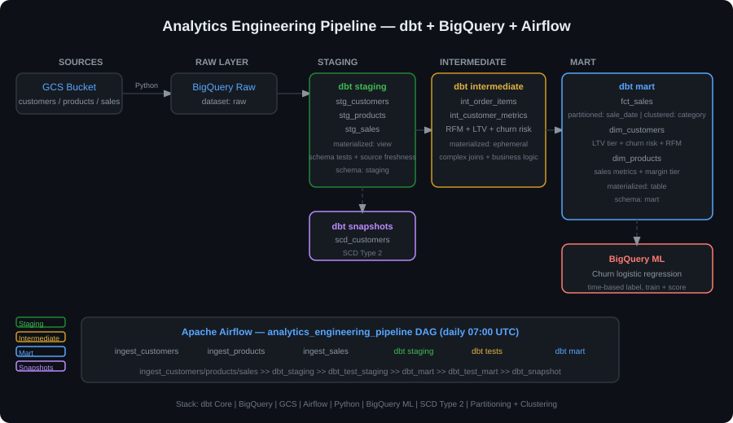

# Analytics Engineering with dbt + BigQuery + Airflow


End-to-end analytics engineering project that loads raw retail data from GCS into BigQuery and transforms it through a three-layer dbt pipeline (staging → intermediate → mart), producing analytics-ready data marts for customer analytics, product performance, and sales reporting — fully orchestrated by Apache Airflow.

## Architecture



## Data Flow

```
GCS (raw CSV)
   └── Python ingestion (full / incremental MERGE)
         └── BigQuery raw layer
               └── dbt staging     (views — clean + cast)
                     └── dbt intermediate  (ephemeral — joins + RFM)
                           └── dbt mart    (tables — fct_sales, dim_customers, dim_products)
                                 └── BigQuery ML  (churn model, time-based label)
                                 └── dbt snapshots (SCD Type 2 — scd_customers)
```

## Project Structure

```
analytics-engineering-dbt-bigquery/
├── data/                        # Synthetic sample CSVs (customers, products, sales)
├── scripts/
│   └── generate_sample_data.py  # Regenerates data/ (seeded, fake names)
├── ingestion/
│   └── load_to_bigquery.py      # GCS → BQ raw (full load or MERGE upsert)
├── dbt_project/
│   ├── dbt_project.yml          # Materialisations + schemas (staging / mart)
│   ├── profiles.yml.example     # Dev + prod BigQuery connection
│   ├── models/
│   │   ├── staging/             # Views: clean + cast; schema.yml = sources, freshness, tests
│   │   ├── intermediate/        # Ephemeral joins + RFM
│   │   └── mart/                # fct_sales (partitioned + clustered), dim_customers, dim_products
│   ├── snapshots/scd_customers.sql   # SCD Type 2 customer history
│   ├── tests/                   # assert_positive_revenue, assert_no_orphan_sales
│   └── macros/                  # generate_surrogate_key, generate_schema_name
├── airflow/dags/analytics_pipeline_dag.py
├── sql/
│   ├── bigquery_ml_churn.sql    # BigQuery ML churn model (time-based label)
│   ├── window_functions_showcase.sql
│   └── customer_cohort_analysis.sql
├── terraform/                   # BQ datasets, raw bucket, service account
├── docker-compose.yml           # Local Airflow (+ optional dbt runner)
├── legacy_v1/                   # First version of the project (May 2024), kept for history
├── snapshots/architecture.svg
├── .env.example
└── requirements.txt
```

## Key Features

**dbt Layer Design**
- `staging` — thin views that clean, cast, and rename raw columns; no business logic.
- `intermediate` — ephemeral models that join tables and compute RFM metrics, LTV tier, and a rule-based churn-risk segment.
- `mart` — tables: `fct_sales` partitioned by `sale_date` and clustered by `category/country/channel`; `dim_customers` with full RFM profile; `dim_products` with sales performance.

**Data Quality**
- Column-level schema tests: `unique` + `not_null` on primary keys, `not_null` on email and sale customer, `accepted_values` on channel.
- Custom singular tests: `assert_positive_revenue`, `assert_no_orphan_sales`.
- Source freshness on `raw.sales` (`loaded_at_field` = sale date; warn after 2 days, error after 7). On the static sample data this check warns by design.

**SCD Type 2 Snapshots**
- `scd_customers` tracks changes to `email`, `country`, `city`, `is_active` over time using dbt's `check` strategy.

**Ingestion**
- `load_to_bigquery.py` supports full WRITE_TRUNCATE loads and incremental MERGE upserts (it creates the target on the first incremental run).

**Advanced SQL**
- Window functions: running totals, 30-day moving averages, LAG/LEAD, RANK, cohort retention.
- BigQuery ML: logistic regression churn model with a time-based label (no purchase in the 90 days after a cutoff), trained, evaluated, and scored entirely in SQL.

## dbt Models

| Model | Layer | Materialisation | Description |
|---|---|---|---|
| `stg_customers` | Staging | View | Normalised customer records |
| `stg_products` | Staging | View | Products with margin_pct + tier |
| `stg_sales` | Staging | View | Sales with net_revenue |
| `int_order_items` | Intermediate | Ephemeral | Joined order items grain |
| `int_customer_metrics` | Intermediate | Ephemeral | RFM + LTV + churn risk |
| `fct_sales` | Mart | Table | Fact table, partitioned + clustered |
| `dim_customers` | Mart | Table | Customer dim with LTV tier |
| `dim_products` | Mart | Table | Product dim with sales metrics |
| `scd_customers` | Snapshot | Snapshot | SCD Type 2 customer history |

## Quick Start

```bash
# 1. Clone + install, create dbt_project/profiles.yml
git clone https://github.com/jaiminbabariya7/analytics-engineering-dbt-bigquery.git
cd analytics-engineering-dbt-bigquery
make setup

# 2. Configure environment
cp .env.example .env
# Fill in GCP_PROJECT_ID, GOOGLE_APPLICATION_CREDENTIALS, GCS_RAW_BUCKET
set -a; . ./.env; set +a

# 3. Infrastructure: raw/staging/mart/snapshots datasets, raw bucket, service account
make terraform-init terraform-apply

# 4. Upload the synthetic CSVs and load the raw tables
make upload-data        # data/*.csv -> gs://$GCS_RAW_BUCKET/raw/<table>/<table>.csv
make load-raw           # full loads into BigQuery `raw`

# 5. Transform, test and snapshot
make dbt-build          # dbt run + test + snapshot
make dbt-freshness      # source freshness (warns on static sample data)

# 6. Churn model
make churn-model

# 7. Optional: local Airflow running the daily DAG
make dev-up             # http://localhost:8080
```

## Environment Variables

| Variable | Description |
|---|---|
| `GCP_PROJECT_ID` | Google Cloud project ID |
| `GOOGLE_APPLICATION_CREDENTIALS` | Path to service account JSON |
| `GCS_RAW_BUCKET` | GCS bucket holding raw CSVs |
| `BQ_RAW_DATASET` | BigQuery dataset for raw tables (default: `raw`) |
| `BQ_DBT_DATASET` | dbt profile default dataset (models themselves go to `staging`, `mart`, `snapshots`) |

## Churn Model (BigQuery ML)

`sql/bigquery_ml_churn.sql` trains a logistic-regression churn model with a **time-based label**, so there is no label leakage:

- **Cutoff:** 90 days before the latest sale date.
- **Features** (`mart.churn_features(as_of)` table function): recency, total orders, orders in the last 90 days, revenue, average order value, tenure, categories bought and average discount, computed only from sales on or before the cutoff.
- **Label:** `is_churned = 1` if the customer made no purchase in the 90 days after the cutoff.
- **Training:** class-weighted logistic regression with a random 20% evaluation split; `ML.EVALUATE` reports precision, recall, ROC AUC and log loss.
- **Scoring:** the same feature function is applied as of the latest date, and `mart.churn_scores` holds each customer's probability of not purchasing in the next 90 days.

The rule-based `churn_risk` column in `dim_customers` is a simple heuristic segment for reporting and is not used as the model label.

## Tech Stack

| Layer | Technology |
|---|---|
| Transformation | dbt Core 1.7 |
| Data Warehouse | Google BigQuery |
| Object Storage | Google Cloud Storage |
| Orchestration | Apache Airflow 2.8 |
| ML | BigQuery ML (Logistic Regression) |
| Language | Python 3.11 |
| Data Modelling | Kimball (fact + dimensions) + SCD Type 2 |